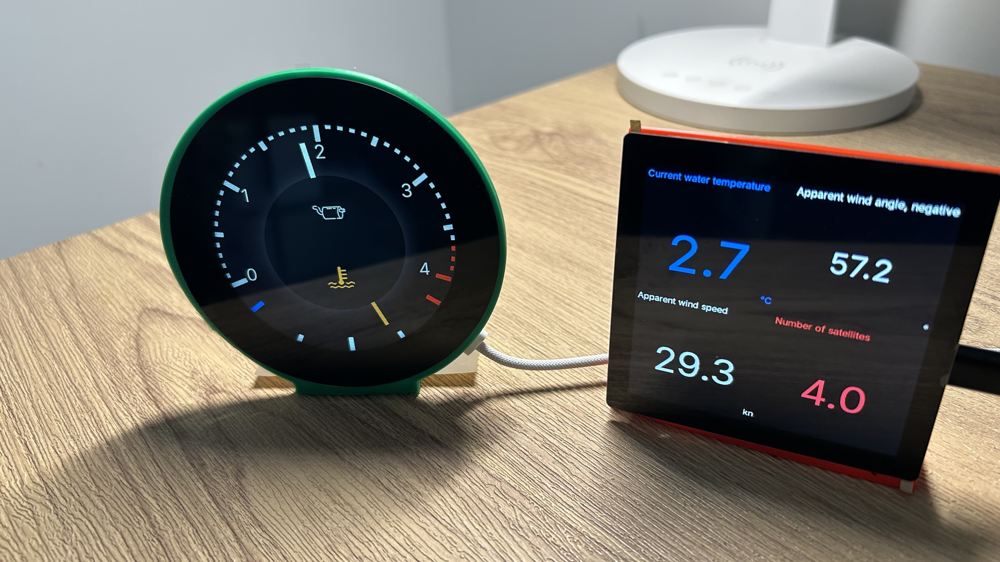

## Easy install — no building needed

**[Install from your browser →](https://boatingwiththebaileys.github.io/Marine-Displays/)**

Plug your display into a computer with a USB-C data cable, open the link above in Chrome or Edge, pick your screen and click **Install**. Ready-built `.bin` files for each display are also attached to every [release](https://github.com/Boatingwiththebaileys/Marine-Displays/releases): `marine-display-*.bin` is a complete image for a fresh install at offset `0x0` with esptool (it replaces the display's saved settings), and `ota-marine-display-*.bin` is an update for the display's own Firmware Update page.

**Already installed?** Open your display's **Firmware Update** page and use **Check for updates**. It shows the latest stable and beta versions and installs them over WiFi, using your phone or computer's internet connection.

**[Help and setup guide →](https://boatingwiththebaileys.github.io/Marine-Displays/help.html)**: setting up screens (including the Wind screen), Signal K paths, gauges and alarms, SD cards, icons and backgrounds, updating, and troubleshooting.

**[Background converter →](https://boatingwiththebaileys.github.io/Marine-Displays/convert.html)**: turn a PNG or JPG into the `.bin` background format in your browser, no script needed.

Want to change the code? The PlatformIO build instructions are in each display's folder.

---

Hi, 

I've created some marine displays using ESP32 display boards. The idea behind the project is for them to be easy to build, WebUI-driven, but still customisable to give you a polished look and feel to the unit. They all use Waveshare ESP32-S3 boards:

| Display | Board | Data | Folder |
|---|---|---|---|
| 4" Square | [ESP32-S3-Touch-LCD-4](https://www.waveshare.com/esp32-s3-touch-lcd-4.htm), 480×480 (V3 and V4) | Signal K over WiFi | `ESP32-S3_Square_Display` |
| 4" Square NMEA 2000 | Same board | NMEA 2000 bus, or a WiFi gateway (Yacht Devices, Actisense, SeaSmart) | `ESP32-S3_Square_Display-NMEA` |
| 2.8" Round | [ESP32-S3-Touch-LCD-2.8C](https://www.waveshare.com/esp32-s3-touch-lcd-2.8c.htm), 480×480 | Signal K over WiFi | `ESP32-S3_2.8in_IPS_LCD_Round_Display` |
| 2.1" Round | ESP32-S3 2.1" round display, 480×480 | Signal K over WiFi | `ESP32-S3_2.1in_IPS_LCD_Round_Display` |
| 4.2" RLCD | ESP32-S3 4.2" reflective LCD, easy to read in sunlight | Signal K over WiFi | `ESP32-S3_RLCD_4.2_Display` |

The round displays follow a gauge-type idea: a smart gauge for engine information, batteries, wind and so on, with icons that change colour on alarm.

The square display builds on that with many more screen types: single, dual and quad value screens, graphs, compass, position, a full wind instrument, AIS, anchor alarm and, on the NMEA 2000 version, attitude (heel and pitch).

The Signal K versions connect over WiFi using a WebSocket and subscribe to the data paths, so values update instantly. The NMEA 2000 version needs no Signal K server: it reads the boat's NMEA 2000 network directly, or the same data from a WiFi gateway.

It's all available for free here, try it, test, tell me what works.

Case - For the Square Display can be found here https://makerworld.com/en/models/2821808-square-marine-display-enclosure 

Video of the round display - Building Custom Marine Displays with ESP32 & SignalK (Gauges, Dynamic Icons & Alerts)
https://youtu.be/d4MlVSbn_wI

Video of the square display - DIY ESP32 Marine MFD – Square Multifunction Boat Display using SignalK Data https://youtu.be/FAPvdz6oN7A

The Baileys

---

## Licence

Free for personal, hobby and non-commercial use under the [PolyForm Noncommercial License 1.0.0](LICENSE.md). You're welcome to build these displays for your own boat, change the code and share it, as long as you keep the copyright notice. **Commercial use isn't allowed**: please don't sell displays running this firmware, build it into a product, or present it as your own work. If you'd like to use it commercially, get in touch.

Third-party libraries keep their own licences; see [THIRD-PARTY-NOTICES.md](THIRD-PARTY-NOTICES.md).

These displays are hobby projects and come with no warranty. Always keep your boat's primary instruments as your main source of navigation and engine information.
